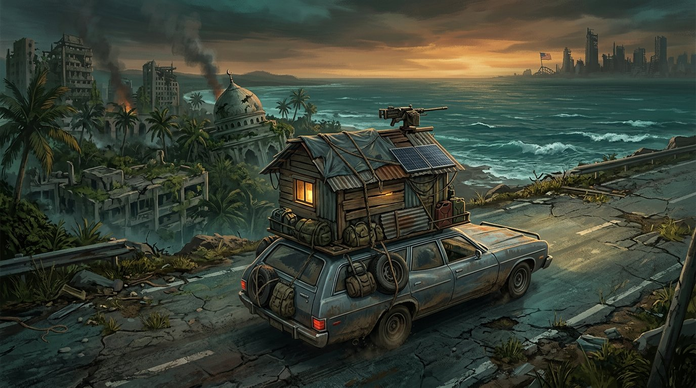

# HOME ON WHEELS

**Jakarta → Washington D.C. — build a house on your car, loot the ruins of the world, and survive the army.**

A complete top-down survival / driving / base-building game that runs in the browser with no build step and no external assets. Everything — the 1,002 recipes, the ruined towns, the survivors, the whole route — is generated locally.



---

## Play

Any static file server works (ES modules need HTTP, not `file://`):

```bash
python3 -m http.server 8000      # then open http://localhost:8000
# or
npm start                         # same thing
```

## Controls

| Key | Action |
| --- | --- |
| `W` `A` `S` `D` / arrows | drive, brake, steer |
| mouse | aim |
| left click (hold) | shoot |
| `E` | loot crate · talk to survivor · open dock · depart |
| `T` | depart to the next zone (at the DEPART gate) |
| `B` | build mode — pick a module, click a roof cell, right-click to remove |
| `C` | crafting book (1,002 recipes) |
| `N` | crew |
| `I` | satchel (weapons, consumables, drones) |
| `M` | route map |
| `H` | help |
| `Esc` | close panels / leave build mode |

## What you actually do

1. **Build a home on the car.** The roof is a 6×4 grid. Floors, walls, storage, beds, solar panels, med bays, drone bays, gardens, turrets and more slot into it. Every module raises your **🏠 home score**, and structural modules actually change the car's stats: armour, material cap, crew berths, power, repair rate, drone slots.
2. **Loot the ruins.** Every zone is dotted with broken houses (or floating wrecks at sea) with glowing containers. Purpler crates are richer. Occasionally a **survivor** is hiding inside.
3. **Craft.** The book contains **1,002 recipes** split across weapons, turrets, drones, building modules, consumables and vehicle upgrades, in five tiers, gated by stations you build on the car: *Field Kit → Workbench → Advanced Workshop → Nano Lab*. Search it, filter by category/tier, or show only what you can build right now.
4. **Fight.** Raiders, brutes, gunner cars, pirates, and eventually the US Army. Turrets and drones fire automatically; you aim with the mouse. Shots eat ammo — without ammo you fire weak improvised rounds.
5. **Recruit survivors.** Each one has a role and a price:
   - 🎒 Scavenger +35% loot
   - 🔧 Engineer auto-repair + 15% cheaper crafts
   - 🎯 Gunner +35% turret damage/rate
   - 💉 Medic constant hull repair
   - 🏎️ Driver +18% speed
   - 💰 Trader +25% cash, better prices
   - 🔭 Sniper shoots on their own
   - ⚙️ Mechanic +40 armour

   They need a **berth** — build Crew Beds.
6. **Get to America.** Buy the **🛶 Raft Kit (950)** and **⛴️ Ship Engine (1500)** at the **Sunda Docks** (or craft improvised versions for a lot of materials). Sea legs also need **40 fuel** each and a hull above 30%.
7. **Final stand.** Miami is crawling with soldiers. In Washington D.C. the army throws **five waves** at your car house; the fifth is the **General's tank**. Destroy it to win.

### The route

| # | Zone | Notes |
| - | ---- | ----- |
| 01 | Kampung Ruins, Java | start, tutorial |
| 02 | Jakarta Outskirts | raider gangs |
| 03 | **Sunda Docks** | buy raft + engine here |
| 04 | Malacca Strait | open water, pirates |
| 05 | Bay of Bengal | storms |
| 06 | **Mumbai Ruins** | dock, resupply |
| 07 | Arabian Sea | long crossing |
| 08 | Atlantic Crossing | hardest water |
| 09 | **Miami Coast** | US Army patrols |
| 10 | **Washington D.C.** | 5-wave finale |

## Systems under the hood

```
index.html            layout, HUD skeleton, panels
css/style.css         all styling (dark/amber post-apocalypse theme)
js/util.js            math, RNG, rounding, tiny WebAudio SFX
js/data.js            resources, loot tables, enemy blueprints, crew roles, shop
js/recipes.js         procedural recipe book — 1,002 unique recipes
js/world.js           10 zones, procedural ruins/wrecks/decor/landmarks
js/render.js          canvas rendering: world, ruins, car house, entities, minimap
js/game.js            simulation: driving, building, loot, craft, combat, travel, save
js/ui.js              DOM interface, crafting book, build tray, panels
js/main.js            boot + requestAnimationFrame loop
```

- **No build step.** Plain ES modules, no framework, no bundler, no image assets in the game itself (the menu art is the only bitmap).
- **Deterministic generation.** Recipes use a seeded PRNG, so item ids are stable and save games only store ids.
- **Save game.** `localStorage` (`how_save_v2`), autosaved every 20 s, on zone changes, crafts, purchases and page unload.
- **Real physics-ish driving.** Acceleration, drag, reverse, speed-scaled steering, drifting slower on water.
- **Combat.** Bullets are entities with spread, splash, chain lightning, armour mitigation, screen shake, and power-hungry turrets.

## Dev tools

```bash
npm install          # dev-only tooling (not needed to play)
npm test             # headless jsdom smoke test: drive, loot, craft, build, sail, win
npm run shots        # render real frames to shots/*.png with a native canvas
```

The smoke test boots the actual game with a fake canvas and exercises the whole loop, including UI panels and the five-wave finale.

## Tips

- Build a **Workbench** early — it unlocks tiers 2–3 of the crafting book.
- Keep a few **Repair Kits** in the satchel; hull damage is permanent until repaired.
- Storage modules raise your material cap (base 900). Over-cap loot is wasted.
- The **DEPART** gate is at the far end of every zone (yellow arrow on the minimap).
- Don't sail without the raft — the car floods fast.
- In D.C., use the 20-second calm before wave 1 to repair and re-deploy.
